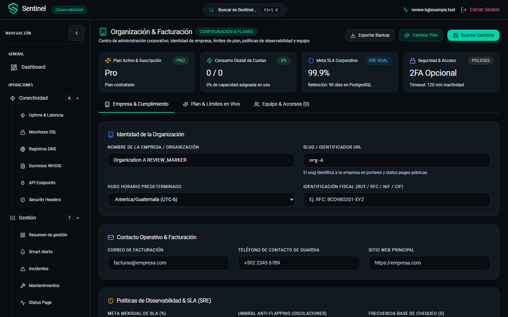

# Revisión de calidad de código y SOLID — Sentinel

Fecha local: 2026-11-08. Árbol de trabajo basado en `d569242`, con los cambios
previos de esta conversación todavía sin commit. Esta revisión incluye ese código
reciente; no lo considera exento por haber superado pruebas funcionales.

## Dictamen y alcance

Hay una base aprovechable: aplicaciones Django por dominio, servicios, serializers,
utilidades de seguridad compartidas, aislamiento por organización en los accesos
revisados y componentes React reutilizables. El cumplimiento de SOLID es **parcial**.
No recomiendo una reescritura: hay defectos concretos y refactorizaciones acotadas
que deben preceder a una ampliación importante del producto.

Se inventariaron 195 archivos TS/TSX del frontend, 249 archivos Python del backend
sin migraciones y 14 Python del agente. Estos conteos incluyen pruebas cuando
están en esos directorios. Se realizó lectura dirigida de autenticación, permisos,
organizaciones, usuarios, alertas, notificaciones, servicios comunes, agente y CI.
El inventario automatizado no equivale a revisión manual exhaustiva de cada línea.

Se ejecutaron la suite Django completa, TypeScript, build, guard del repositorio,
una comparación del contrato que verifica CI y reproducciones adicionales. No se
modificó código de aplicación. Las reproducciones usaron datos ficticios, endpoints
HTTP simulados y no activaron entregas de mensajes o correos a destinatarios reales.

## Hallazgos priorizados

P1: corregir antes de una entrega o ampliación relevante por aislamiento, veracidad
del producto o bloqueo del gate. P2: corregir de forma planificada por comportamiento,
rendimiento o mantenibilidad. No se identificó un P0 en el alcance revisado.

### F01 · P1 · Caché del portal compartida entre cuentas/organizaciones

Referencias: [App.tsx](../frontend/src/App.tsx#L40),
[OrganizationSettingsPage.tsx](../frontend/src/pages/OrganizationSettingsPage.tsx#L92),
[authStore.ts](../frontend/src/store/authStore.ts#L156).

El `QueryClient` del portal vive fuera del ciclo de autenticación. Las claves
`current-organization`, `org-subscription`, `org-members` y `org-invoices` no
incluyen usuario ni organización. Logout elimina credenciales y estado de acceso,
pero no cancela o limpia esa caché. Su frescura por defecto es de 30 segundos y
su retención de cinco minutos.

**Reproducción en Chromium, con respuestas sintéticas:** cargar organización A,
cerrar sesión, autenticar B y navegar dentro de la misma SPA a Organización.
La sesión activa era B y el formulario mostraba el nombre y slug de A; el único
GET de organización registrado correspondía a A. No se recargó el documento.

```json
{"active_organization":"org-B","displayed_name":"Organization A REVIEW_MARKER","organization_requests":["A"]}
```

Esto confirma reutilización de datos entre cuentas en el frontend. No demuestra
que los filtros del backend permitan consultar la organización ajena. La ventana
de frescura explica que no se consulte B al montar; vencer el staleTime por sí
solo no obliga a refrescar una pantalla que ya está montada.

**Corrección recomendada:** claves con identidad y organización; cancelar y retirar
consultas privadas en logout, expiración y cambio de identidad. Cubrir también login
con 2FA y cambios de organización. Probar A→B con respuestas lentas de B y comprobar
que ningún dato de A aparezca bajo B.



### F02 · P1 · Facturas y pagos generados sin una fuente de pagos

Referencias: [OrganizationInvoicesView](../backend/organizations/views.py#L987),
[presentación de recibos](../frontend/src/pages/OrganizationSettingsPage.tsx#L1071).

El endpoint calcula recibos desde la fecha y el precio actual del plan. Devuelve
`status=paid`, etiqueta `Pagada` y una tarjeta fija terminada en `4242`. No exige
un registro de factura, transacción o conciliación, ni está limitado a fixtures o
DEBUG. La UI consume esos datos y ofrece ver el recibo.

**Reproducción aislada:** organización Pro con suscripción `past_due`, sin registro
de pago, devuelve un recibo de USD 29 marcado como pagado y esa tarjeta fija.

**Corrección recomendada:** retirar estos datos sintéticos de la ruta operativa.
Mientras no exista una fuente de facturación real, devolver estado explícitamente
no disponible o datos proforma identificados, sin afirmar cobros ni métodos de pago.
Probar `past_due`, pruebas y cambios de plan sin generar pagos retrospectivos ficticios.

### F03 · P1 · Contrato de API desactualizado: falla la comparación requerida por CI

Referencias: [gate de CI](../.github/workflows/ci.yml#L143),
[referencia versionada](reference-api.json),
[generador](../backend/common/management/commands/document_contracts.py#L41).

Se ejecutó el generador y se compararon los JSON como hace CI. La igualdad es falsa;
faltan cuatro rutas administrativas recientes en la referencia versionada:

- `/api/v1/platform-admin/audit-logs/{log_id}/`
- `/api/v1/platform-admin/audit-options/`
- `/api/v1/platform-admin/catalog/`
- `/api/v1/platform-admin/organizations/{org_id}/classification/`

No hubo rutas retiradas ni cambios en las ya documentadas. Esto reproduce localmente
el fallo de esa condición de CI; no es una consulta de resultados remotos de GitHub.
La suite Django puede pasar aunque falle este paso previo del workflow.

**Corrección recomendada:** regenerar la referencia mediante el comando oficial,
revisar su diff y exigir sincronización en cada cambio de rutas. El inventario
actual no describe por completo payloads/filtros: no sustituye un esquema completo.

### F04 · P2 · Excepciones inesperadas convertidas en errores de cliente

Referencias: [UserListView](../backend/users/views.py#L73),
[RoleDetailView](../backend/users/views.py#L258),
[error_response](../backend/common/responses.py#L21).

Capturas amplias `except Exception` convierten fallos internos en 400 o 404.
`error_response` convierte excepciones genéricas con `str(message)`, por lo que
puede exponer detalles internos. Hay un caso reproducido, no sólo una búsqueda textual.

**Reproducción:** inyectar un `RuntimeError` controlado en creación de usuarios
produce 400 y expone el marcador interno. El mismo tipo de error al recuperar un
rol produce 404 aunque el fallo no sea un recurso inexistente.

**Corrección recomendada:** distinguir validación, ausencia, permisos y fallo interno;
capturar excepciones de dominio conocidas y gestionar las inesperadas en el handler
central con mensaje público seguro, correlación y registro de la excepción original.
Conservar el tratamiento correcto existente para cuotas y otras excepciones previstas.

### F05 · P2 · Listado de usuarios del portal: 2N+1 consultas y respuesta sin paginar

Referencias: [list_users](../backend/users/services.py#L16),
[get_roles/get_teams](../backend/users/serializers.py#L64),
[GET de usuarios](../backend/users/views.py#L33).

Cada usuario dispara consultas de roles y equipos. El endpoint devuelve el conjunto
completo. Se midieron **11 consultas para 5 usuarios y 51 para 25**; un GET con 26
usuarios devolvió los 26 en una respuesta. Esto corresponde al portal; el directorio
del superadmin tiene su paginación propia y no es el endpoint medido.

**Corrección recomendada:** precargar equipos y asignaciones de rol, y adaptar el
serializer para consumir las relaciones precargadas. Añadir paginación compatible
y actualizar consumidores. Verificar que el número de consultas no crezca por fila.
Sólo añadir prefetch al queryset no arreglará el método que crea su propio filtro.

### F06 · P2 · Roles personalizados separados de la autorización efectiva

Referencias: [modelos de roles](../backend/users/models.py#L7),
[user_has_permission](../backend/users/services.py#L147),
[IsAdminOrReadOnly](../backend/common/permissions.py#L26),
[OperationalAPIView](../backend/common/subscriptions.py#L45).

Existen roles, permisos y asignaciones, pero los endpoints revisados deciden
mutaciones mediante `is_staff`/`is_superuser`. La búsqueda de usos de
`user_has_permission`/`get_user_permissions` sólo encuentra sus definiciones y
la llamada entre esos helpers.

**Reproducción:** un miembro con `users.manage` en un rol obtiene `True` del helper
y `False` de la política HTTP; un administrador sin ese permiso obtiene el inverso.
Esto no reproduce una escalada de privilegios: confirma que la autorización real
es binaria y no aplica el catálogo de permisos personalizados.

**Corrección recomendada:** definir qué capacidades se ofrecen. Si se mantienen
roles granulares, integrar una política central y pruebas por permiso; si sólo se
ofrece admin/viewer, documentar ese contrato y evitar prometer restricciones que
esos roles no aplican. No cambiar privilegios masivamente durante un refactor.

### F07 · P2 · Responsabilidades concentradas en componentes grandes

Referencia: [AlertsPage](../frontend/src/pages/AlertsPage.tsx#L77).

Diez archivos del frontend superan mil líneas. AlertsPage tiene 1.804 líneas y,
medido mediante AST, 11 estados, tres consultas y 11 mutaciones; además concentra
formularios, navegación por módulos, filtros y drawers. Otros ejemplos son
OrganizationSettingsPage (1.387) y ProfilePage (1.335).

El número de líneas no demuestra por sí mismo una violación de SOLID. Aquí la
mezcla de motivos de cambio, datos, acciones y presentación sí justifica dividir
responsabilidades. Los archivos grandes de backend agrupan varias clases y no deben
calificarse automáticamente como una única clase que incumple SRP.

**Corrección recomendada:** extraer hooks por caso de uso y componentes por flujo
(listado, regla, detalle y acciones), manteniendo el estado y la caché necesarios.
Repetir el patrón gradual ya iniciado con AuthCard, NavbarFrame y SidebarFrame.

### F08 · P2 · Políticas y selección de implementaciones duplicadas

Referencias: [planes del frontend](../frontend/src/components/organization/UpgradePlanModal.tsx#L62),
[PLAN_LIMITS](../backend/organizations/models.py#L24),
[despacho de notificaciones](../backend/notifications/services.py#L274),
[despacho de pruebas](../backend/notifications/services.py#L450),
[evaluación de alertas](../backend/alerts/services.py#L829).

El modal del portal duplica precios y prestaciones del backend y modifica textos
mediante reemplazos para beta. En notificaciones, dos cadenas de selección por tipo
enumeran los mismos transportes. Alertas mantiene otra selección extensa por condición.
La duplicación de planes es riesgo de deriva; no se afirma que todos los importes
actuales estén desincronizados.

**Corrección recomendada:** un catálogo de planes autorizado para sus consumidores,
sin reutilizar desde el portal endpoints exclusivos del superadmin. Un registro
explícito de handlers permitidos para enviar/probar notificaciones y evaluadores
por condición. Abstraer sólo los límites donde cambia una implementación: transporte,
reloj o proveedor; no añadir repositorios/interfaces por obligación alrededor de todo el ORM.

### F09 · P2 · Tipado estricto con escapes y controles de mantenibilidad incompletos

Referencias: [tsconfig](../frontend/tsconfig.json#L14),
[scripts frontend](../frontend/package.json#L6),
[CI Python](../.github/workflows/ci.yml#L108).

TypeScript tiene `strict=true`, pero se contaron **133 usos explícitos del tipo
`any` en 51 archivos**, usando AST y excluyendo dependencias. `noUnusedLocals` y
`noUnusedParameters` están desactivados. No se encontró configuración o script de
ESLint en el frontend. Flake8 en CI selecciona errores críticos de sintaxis y
familias concretas; no constituye una revisión completa de estilo o complejidad.

**Corrección recomendada:** contratos tipados de API y errores (`unknown` con
validación), tipos JSON recursivos cuando proceda, lint de React Hooks y reglas de
imports/variables. Adoptar una línea base gradual para no mezclar un formateo masivo
con correcciones funcionales. Compilar no demuestra que un payload cumpla el contrato.

## Lectura por principio SOLID

| Principio | Evaluación basada en esta revisión |
| --- | --- |
| S · Responsabilidad única | Parcial: servicios y componentes compartidos ayudan; algunas páginas mezclan demasiadas tareas (F07) |
| O · Abierto/cerrado | Parcial: añadir transportes/condiciones exige modificar varios selectores (F08) |
| L · Sustitución de Liskov | No se confirmó una violación concreta en la muestra; no equivale a certificar todo el árbol de herencia |
| I · Segregación de interfaces | Hay señales favorables en componentes visuales de props acotadas; no se justifica exigir interfaces OO a toda función React/Django |
| D · Inversión de dependencias | Parcial: separación por servicios, pero con dependencias concretas estáticas; conviene unificar límites de transporte y políticas, no envolver todo el ORM |

SOLID no es un porcentaje de clases ni una exigencia de usar herencia. Lo relevante
es poder cambiar un caso de uso sin romper otros, probar políticas de forma aislada
y conservar contratos. La corrección de F01–F06 importa más que crear abstracciones.

## Prácticas que conviene conservar

- Sesión de plataforma independiente, superadmin real y 2FA, con duración corta y
  sello de credenciales: `accounts/platform_auth.py`.
- Hash de tokens API y comprobación de identidad/estado al autenticar:
  `accounts/authentication.py`.
- Utilidades comunes de salida HTTP segura y redirecciones desactivadas:
  `common/safe_http.py`. No se certificaron todas las posibles rutas de salida.
- Invariante del último administrador y protección de superadmins bajo bloqueo de
  organización: `common/membership.py`.
- Admisión atómica de scans y liberación de reservas si falla el broker:
  `common/scan_limits.py`.
- En notificaciones sí existe `select_for_update` y comprobación de estado enviado;
  no se reporta una carrera de doble envío por ausencia de ese bloqueo.
- Agente separado en ejecución, entrega y seguridad; diario SQLite y contenedor
  sin root: `sentinine/delivery.py` y Dockerfile. Lectura estática en esta revisión.
- Pruebas y configuración de CI/deploy con gates explícitos; el contrato desactualizado
  debe corregirse para que ese mecanismo no bloquee la revisión actual.

## Evidencia y límites

| Comprobación ejecutada ahora | Resultado |
| --- | --- |
| Suite Django completa en PostgreSQL/Redis aislados | 332 aprobadas |
| TypeScript `--noEmit`, build Vite y guard de archivos/secretos | Aprobados |
| Comparación de API generada frente a referencia | Diferencia reproducida: cuatro rutas nuevas faltantes |
| Probes Django en otra base desechable | Cuatro reproducciones confirmadas: errores, roles, consultas y facturas |
| Probe Chromium con respuestas ficticias | Reutilización de datos A bajo sesión B reproducida |

Los probes afirman el comportamiento defectuoso actual para documentarlo; su
resultado OK **no significa que esos defectos estén corregidos**. Al implementar
correcciones deben convertirse en regresiones que exijan el comportamiento deseado.
Scripts locales ignorados: `.tmp/quality_review_probes.py` y
`frontend/.tmp/quality-cache.spec.ts` con su configuración de Playwright.

No se ejecutaron auditorías actualizadas de CVEs, pentest completo, revisión de
producción ni CI remoto. No se repitió la suite Chromium general en esta revisión;
su evidencia previa se documenta en los informes de UI y no se presenta como nueva.

## Orden recomendado de corrección

1. Cerrar el problema de caché entre identidades y retirar recibos/pagos inventados.
2. Sincronizar el contrato y añadir regresiones de aislamiento y veracidad.
3. Corregir la traducción de errores, el listado de usuarios y el contrato de roles.
4. Dividir componentes de mayor cambio, centralizar políticas duplicadas y adoptar
   lint/tipos gradualmente. Mantener el monolito modular y sus pruebas; una reescritura
   no es necesaria para resolver estos hallazgos.
