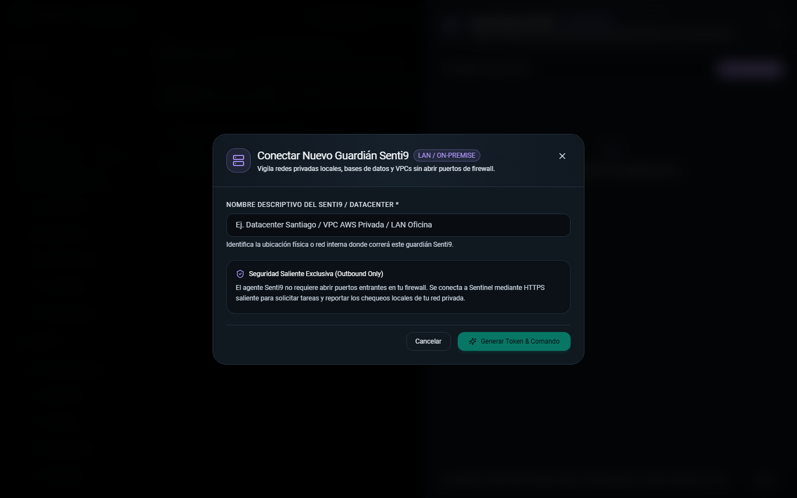
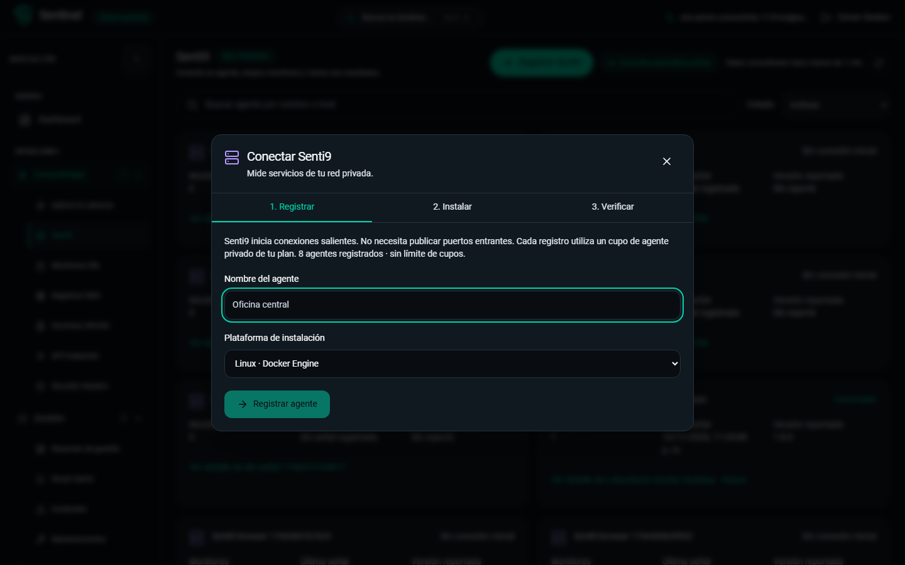

# Conectividad y Senti9: implementación y evidencia local

Fecha: 2026-11-10. Rama de trabajo: `codex/connectivity-senti9-20261110`, sobre `46e1787`.

Implementación del [análisis C01–C14](CONNECTIVITY_REVIEW_2026-11-10.md). Conserva Django/React, aislamiento por organización, permisos, cuotas, protocolo v2 y telemetría del agente. Las pruebas funcionales utilizan datos aislados; no comprueban destinos de clientes ni envían correos reales.

## Resultado por hallazgo

| ID | Cambio implementado | Evidencia y límite |
| --- | --- | --- |
| C01 | Contrato plano de seis tipos validado al guardar. HTML/JSON inválido falla si se exige esquema; booleanos no pasan como enteros. Diferencias por campo sin valores sensibles. | Regresiones de tipos, respuestas no JSON, contratos desconocidos y cabeceras secretas. Objetos anidados siguen fuera de alcance. |
| C02 | DNS separa intento, última respuesta válida y cambio real. TIMEOUT, NXDOMAIN y NO_ANSWER conservan valores anteriores; recuperación y reordenamiento no inventan cambios. Referencia esperada opcional y resolver visibles. | Regresiones con transporte simulado; estado inicial desconocido, sin rellenar mediciones históricas. |
| C03 | Operaciones masivas sin reintentos individuales automáticos. Resultado por recurso: aplicado, omitido, fallido o no determinado; selección pendiente conservada. | Django y Chromium fuerzan un 503 ambiguo y verifican cero DELETE individuales. |
| C04 | Los seis directorios distinguen carga, error sin datos, datos anteriores, vacío y filtros sin coincidencias. Reintentar conserva el contexto. | Recorridos de lectura y errores; no se utiliza un error como evidencia de lista vacía. |
| C05 | Retirados fallbacks inventados de latencia, TLS, SAN, vigencia y promedios sin muestras. Límite configurado separado de medición. | Pruebas de métricas ausentes, paleta neutral y límites actuales/aplicados. |
| C06 | Métodos HTTP normalizados y filtros en servidor; catálogo DNS coherente, incluyendo PTR, SRV y CAA. | Regresiones de filtro, recarga y contrato de tipos. |
| C07 | CSP exige directivas interpretables antes de puntuar. HSTS y CSP editables, sin aplicación automática; alcance acotado de la puntuación. | Casos de directiva desconocida, política parcial y plantillas. No equivale a auditoría de seguridad integral. |
| C08 | SSL usa advertencia a 30 días y crítico a 7; distingue vencimiento, certificado inválido y fallo de medición. | Filtros, ausencia de datos y presentación. No cambia umbrales particulares de reglas existentes. |
| C09 | Admisión después del commit, recibos persistentes, fallo de broker registrado y progreso recuperable. Configuración validada otra vez antes de ejecutar y de aplicar resultados. | Broker ambiguo, cambio de configuración y ejecución vencida. Leer progreso nunca admite una nueva comprobación. |
| C10 | Seis directorios paginados en servidor a 25, filtros/búsqueda, selección por página y CSV filtrado independiente. | Fixtures de 25/100/1000 recursos en los seis módulos: 25 resultados, total exacto y crecimiento máximo de dos consultas frente al caso de 25. No es un benchmark de latencia productiva. |
| C11 | RDAP mediante bootstrap IANA y HTTP seguro, sin redirects, con respuesta acotada; fallback WHOIS y fuente visible. Fechas ISO y datos parciales conservados. | Regresiones de datos parciales y tamaño máximo. La disponibilidad de cada registro/TLD depende de su proveedor. |
| C12 | Patrón móvil de Monitoring conservado; otros módulos usan tarjetas en pantallas estrechas. Selección con nombre/estado, foco y área de 44 px en tablas. | Capturas de siete secciones en tres tamaños; teclado y comprobación de ausencia de overflow del documento. No constituye certificación WCAG. |
| C13 | Aprovisionamiento informa creado/existente/fallido por módulo y ofrece configurar regla/canal. Una selección explícita vacía termina sin enviar trabajos al broker. | Resultado parcial persistente; no anuncia alertas listas sin configuración. |
| C14 | Alta de Uptime con campos básicos y parámetros avanzados. Senti9 con registro, instalación y verificación; detalle operativo separado del diagnóstico. | Recorridos de primer monitor y primera señal; el estudio de usabilidad con participantes queda separado. |

Implementación central: [directorios](../backend/common/connectivity_directory.py), [admisión y límites](../backend/common/scan_limits.py), [recibos](../backend/common/executions.py), [contexto de ejecución](../backend/common/execution_context.py), [regresiones](../backend/common/tests_connectivity_trust.py), [directorios React](../frontend/src/hooks/useConnectivityDirectory.ts).

## Senti9: opciones y flujo validado

| Opción | Resultado esperado y obtenido | Alcance |
| --- | --- | --- |
| Sección `/senti9` | Directorio paginado con búsqueda y ciclo sin conexión inicial/conectado/desconectado/revocado. Ver detalle conserva contexto. | Administrador opera; lectura de Monitoring consulta. |
| Registrar | Nombre y plataforma; cuota identificada; token fuera de consultas/cachés y sin versión ficticia. | Registro con API aislada. |
| Instalar | Archivo de token preparado antes del comando, Bash/PowerShell, perfil versionado, imagen privada o paquete local. | Token de una sola revelación; se revocan URLs de descarga. |
| Verificar | Primera señal cada 10 s, máximo 2 min; después “Conexión sin confirmar”, con reintento. | Chromium con reloj controlado y señal autenticada; no confunde conexión con servicio saludable. |
| Primer monitor privado | Agente preseleccionado; se permite guardarlo desconectado con aviso de primera medición pendiente. | Prueba real de selección y runtime Docker con mediciones HTTP recibidas. |
| Operación | Conexión, entregas del servidor y cola local en bloques independientes; versión realmente reportada. | No se suman cifras de fuentes diferentes. |
| Diagnóstico local | Configuración, token, CAs, estado local y autenticación mediante GET de diagnóstico. | No solicita tareas, ejecuta monitores ni inicializa el diario. |
| Rotar | Conserva bloqueos por conexión, drenaje y entrega; descarga del nuevo token sólo durante la acción. | Regresiones backend/agente; no se debilitaron los bloqueos existentes. |
| Retirar | Motivo obligatorio, impacto previo, token inválido, monitores pausados e historial/asignaciones conservados. | Archivo y cuota activa excluyen revocados. Una autenticación anterior no elude la revocación. |
| Recuperación | Diario persistente, deduplicación, backpressure y retorno a 1.7.0 sin repetir una petición con efectos inciertos. | 61 pruebas de agente y prueba de diario con imágenes exactas, sin red. |

La prueba de runtime utiliza un contenedor Linux sobre Docker Desktop en Windows, UID 10001, filesystem de sólo lectura, token montado de sólo lectura, capacidades retiradas y volumen propio. El servidor de laboratorio está configurado expresamente; nunca se deduce del host de una petición. La conexión al host sigue la [documentación de Docker](https://docs.docker.com/desktop/features/networking/networking-how-tos/).

El agente real de laboratorio reportó 1.8.0 y obtuvo **66 mediciones HTTP**, con último resultado `up`. Al cerrar la prueba se drenó y detuvo el contenedor: revocación comprobada, token rechazado, monitor pausado y las 66 mediciones y su asignación conservadas. El archivo privado se retiró tras invalidarlo. [Evidencia de runtime y retiro](assets/connectivity-implementation-20261110/senti9-runtime-final.json), [diagnóstico](assets/connectivity-implementation-20261110/senti9-diagnostics.json) y [compatibilidad del diario](assets/connectivity-implementation-20261110/senti9-compatibility.json).

No se realizó un piloto en una máquina Linux independiente. Las instrucciones Linux y PowerShell, rutas con espacios, CAs, ausencia de token y errores de acceso tienen cobertura automatizada; el comportamiento de una VPN, antivirus, permisos o registro privado concreto debe probarse en ese entorno.

Las reproducciones de fallos HTTP, JSON, DNS, TLS, RDAP y broker usan transportes controlados en pruebas Django. El recorrido privado HTTP utiliza el runtime real descrito arriba. No se ensayaron incidentes contra servicios públicos o clientes.

## Contratos y migraciones

Se conserva `data`. `page` activa paginación compatible, página de 25, total exacto y `has_next`; sin `page` se conserva la colección anterior durante la transición. CSV aplica filtros y no limita la exportación a la página. Los totales globales de Monitoring tienen alcance de organización, anterior a filtros; las otras cifras conservan su fuente de estadísticas.

Se añaden recibos `GET /api/v1/scan-executions/{id}/`, metadatos de disponibilidad/medición, respuestas masivas por recurso y secciones de Senti9 `detail/`, `installation/`, `revoke/` y `diagnostic/`. Las respuestas 202 conservan campos anteriores y añaden seguimiento. Los recibos de agente normalizan únicamente evidencia disponible; el protocolo actual no comunica el inicio exacto de cada tarea.

El contrato oficial y los tipos generados se actualizaron juntos: [OpenAPI](reference-api.json) y [tipos TypeScript](../frontend/src/types/generated/api.ts). Consultar un perfil no crea ni rota tokens. Los diagnósticos y ejecuciones omiten payloads, secretos y cuerpos de tareas.

Ocho migraciones aditivas probadas en PostgreSQL aislado desde los datos existentes:

- `api_checks.0004`: diferencias del esquema.
- `common.0002` y `common.0003`: recibos y huella de configuración.
- `dns_monitor.0003`: intento, referencia esperada, resolver y última respuesta válida.
- `domain.0003`: procedencia, última consulta válida y bloqueo desconocido.
- `monitoring.0009`: revocación auditada.
- `monitoring.0010`: resultado de aprovisionamiento.
- `ssl_monitor.0004`: error y última medición válida.

No contienen reclasificación ni acciones sobre recursos de clientes. Los registros previos comienzan sin evidencia nueva. No volver a un backend que ignore revocaciones; conservar este control aunque el runtime vuelva a 1.7.0.

Después de validarlas en aislamiento, se aplicaron las ocho migraciones al contenedor habitual **de desarrollo** `sentinel_backend`, conforme a la autorización previa de actualizar el entorno local. `migrate --plan` quedó sin operaciones pendientes. Backend, worker y Beat locales se recargaron con el código actual; frontend usa su montaje de desarrollo. Salud en `localhost:8000`, módulo Senti9 y CSS en `localhost:3001`: HTTP 200. No se ejecutó el Compose productivo ni se crearon fixtures en la base habitual. [Registro de migraciones locales](assets/connectivity-implementation-20261110/local-migrations.log).

## Validación local

| Control | Resultado |
| --- | --- |
| Django completo, PostgreSQL/Redis aislados | **399 aprobadas**, 115,245 s, después del último cambio backend. |
| Agente Senti9 | **61 aprobadas**, 5,101 s. |
| TypeScript y build Vite | Aprobados después de los últimos cambios de código. |
| ESLint / formato / Ruff | Aprobados. |
| OpenAPI y generación de tipos | Referencia idéntica a la generación oficial; tipos reproducibles. |
| Migraciones sin generar | `makemigrations --check --dry-run`: sin cambios. |
| Guardia de secretos versionables | Aprobada; no sustituye una auditoría de base de datos o historial Git. |
| Chromium, descubrimiento completo | **246 aprobadas, 8 omitidas, 0 fallidas**, 6,4 min. Incluye API real aislada y transportes simulados; no son 246 comprobaciones externas. |
| Paquete 1.8.0 y retorno 1.7.0 | Integridad verificada; cuatro fases seed/upgrade/rollback/resume aprobadas. Firma y publicación pendientes. |

CI: se instala npm/Chromium antes de arrancar los contenedores que montan el repositorio, evitando que creen `node_modules` con otro propietario. Se mantienen controles de contratos, tipos, lint y pruebas. El fixture aislado permite seleccionar Enterprise sin modificar organizaciones existentes. Este cambio de workflow no acredita una ejecución remota aprobada.

Las ocho omisiones son recorridos anteriores de superadmin/calidad protegidos por `PLATFORM_ISOLATED` y `QUALITY_ISOLATED`; requieren sus propios datos semilla y no se activaron en esta ejecución. Sus recorridos simulados y las regresiones generales sí forman parte de las 246 aprobadas. No se presentan esas omisiones como aprobaciones.

Durante el cierre se corrigieron la compresión del nombre del monitor en tablas, el orden del detalle para conservar gráfica y comprobaciones en la primera pantalla, el uso del patrón móvil existente y controles de selección sin nombre/área suficiente. Los dobles de transporte se actualizaron para aceptar paginación y filtrar exclusivamente los directorios de Conectividad; el opt-out exige ahora ausencia de trabajos vacíos. La última ejecución completa usa esos cambios y no requirió reintentos.

Los registros de comandos locales permanecen en `.tmp/connectivity-*` y `.tmp/senti9-*`, fuera de Git. El candidato verificable está en `dist/senti9-1.8.0-rc.1`; no incluye tokens. La [guía operativa 1.8.0](../sentinine/release/RELEASE_1_8_0.md) describe preparación, CAs, diagnóstico, actualización, drenaje y retorno.

## Comparación visual

Antes y después con el mismo viewport de 1440×900, escala normal y fixtures:

| Antes | Después |
| --- | --- |
|  |  |

- [Operación de Senti9: conexión, entrega y cola](assets/connectivity-implementation-20261110/senti9-operation-after-1440.png).
- [Primera señal](assets/connectivity-implementation-20261110/senti9-first-signal.png).
- Alta y comandos a [1440](assets/connectivity-implementation-20261110/senti9-command-1440.png), [1366](assets/connectivity-implementation-20261110/senti9-command-1366.png) y [390](assets/connectivity-implementation-20261110/senti9-command-390.png): perfil leído de la API aislada, registro interceptado y token inerte para revisar la presentación sin crear agentes. [Resultados de esa revisión](assets/connectivity-implementation-20261110/senti9-setup-responsive.json).
- [Uptime 1440](assets/connectivity-implementation-20261110/monitoring-1440.png), [1366](assets/connectivity-implementation-20261110/monitoring-1366.png), [390](assets/connectivity-implementation-20261110/monitoring-390.png).
- [SSL 1440](assets/connectivity-implementation-20261110/ssl-1440.png), [1366](assets/connectivity-implementation-20261110/ssl-1366.png), [390](assets/connectivity-implementation-20261110/ssl-390.png).
- [DNS 1440](assets/connectivity-implementation-20261110/dns-1440.png), [1366](assets/connectivity-implementation-20261110/dns-1366.png), [390](assets/connectivity-implementation-20261110/dns-390.png).
- [Dominios 1440](assets/connectivity-implementation-20261110/domains-1440.png), [1366](assets/connectivity-implementation-20261110/domains-1366.png), [390](assets/connectivity-implementation-20261110/domains-390.png).
- [API 1440](assets/connectivity-implementation-20261110/api-checks-1440.png), [1366](assets/connectivity-implementation-20261110/api-checks-1366.png), [390](assets/connectivity-implementation-20261110/api-checks-390.png).
- [Security Headers 1440](assets/connectivity-implementation-20261110/security-headers-1440.png), [1366](assets/connectivity-implementation-20261110/security-headers-1366.png), [390](assets/connectivity-implementation-20261110/security-headers-390.png).
- [Senti9 1440](assets/connectivity-implementation-20261110/senti9-1440.png), [1366](assets/connectivity-implementation-20261110/senti9-1366.png), [390](assets/connectivity-implementation-20261110/senti9-390.png).

## Pasos externos y operación

La instalación nueva requiere `SENTI9_CONTROL_URL` explícita y una distribución autorizada. `SENTI9_DISTRIBUTION_READY` se activa sólo tras verificar su disponibilidad. Laboratorio HTTP requiere configuración explícita; producción utiliza HTTPS. El Compose histórico conserva su volumen para no perder identidad ni pendientes; agentes nuevos utilizan nombres únicos del perfil.

El Compose de desarrollo define la dirección del laboratorio y admite `host.docker.internal`; el productivo recibe una dirección configurable sin valor predeterminado. El perfil local se comprobó sin crear agente, y la distribución continúa marcada como pendiente de publicación.

Permanecen separados: CI remoto, firma con clave confiable, publicación en registro privado, piloto en hosts Linux independientes, despliegue y actualización de agentes de clientes. No hay instalación en equipos ajenos, cobros, correos reales, cambios masivos ni ejecución privada de esquemas JSON de API Endpoints en esta entrega.
