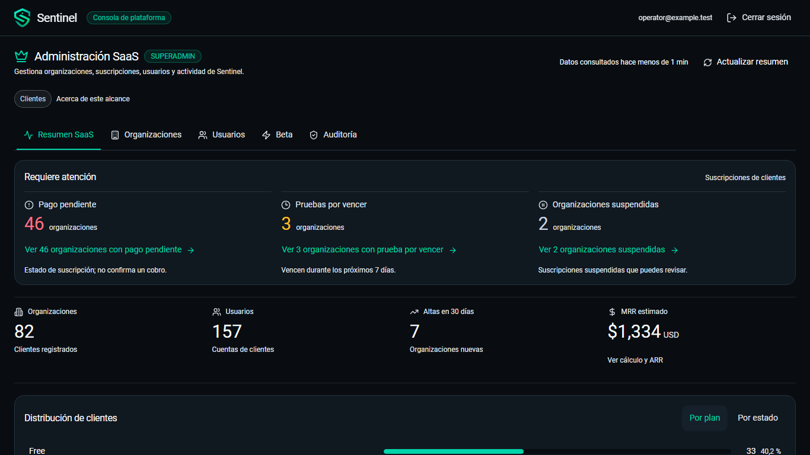
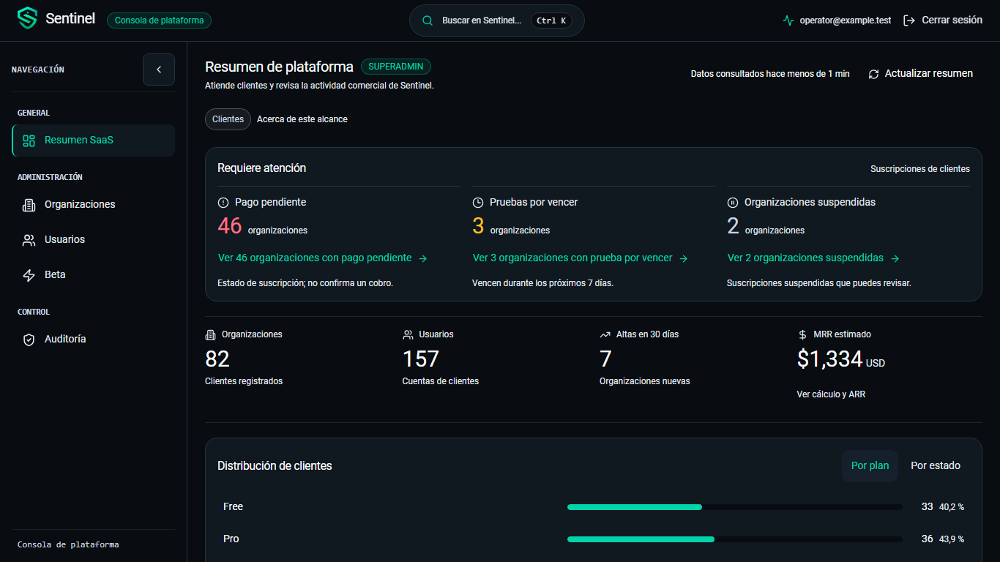
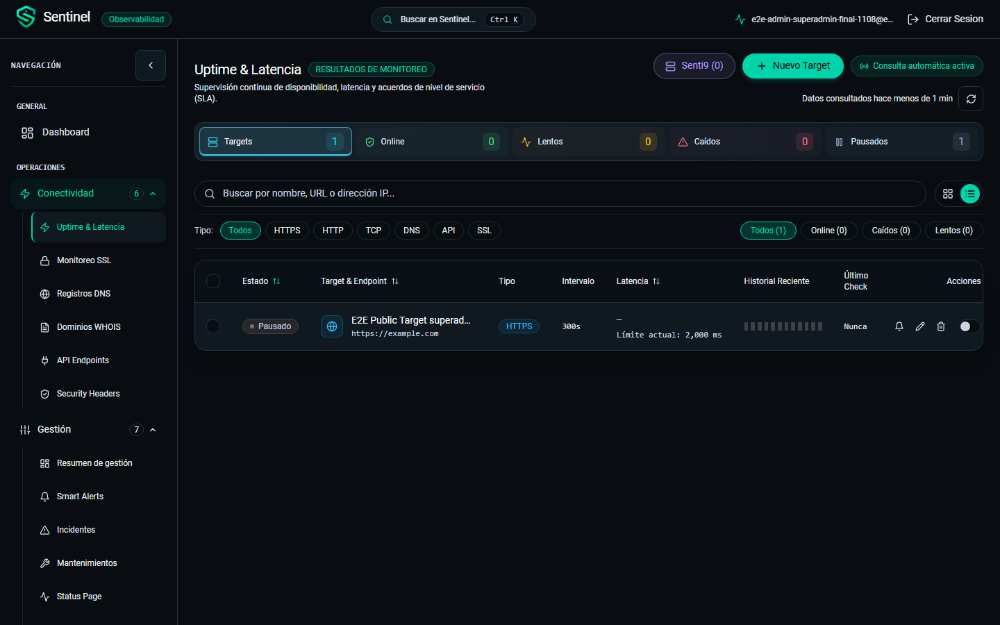
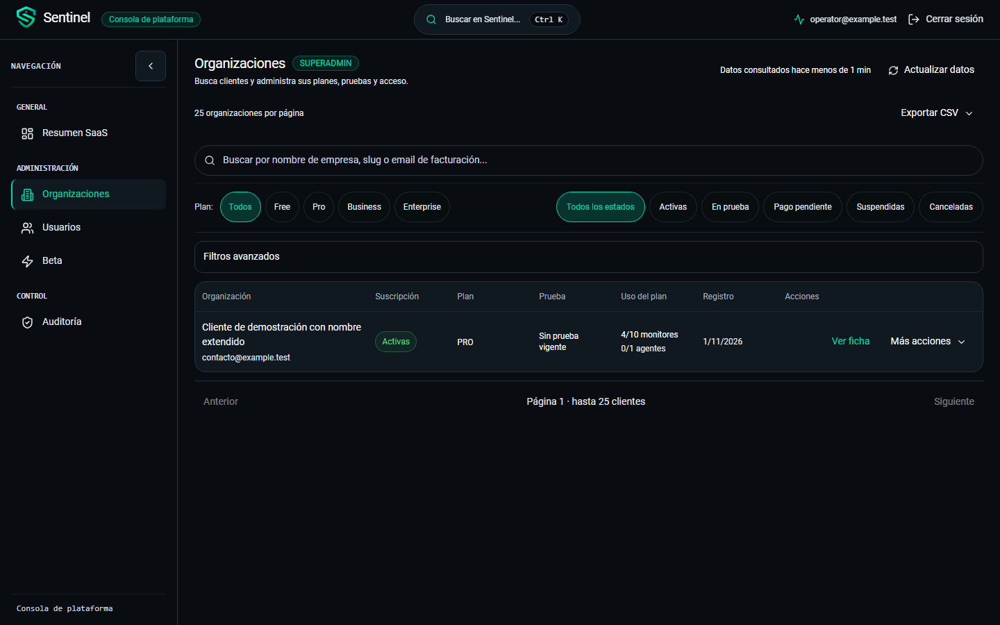
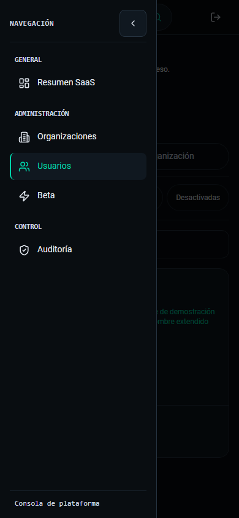
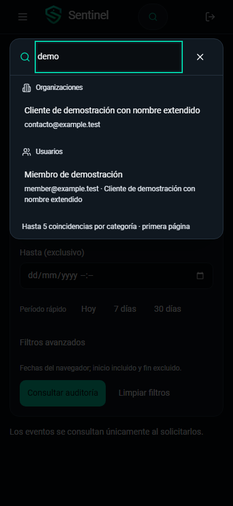

# Consola superadmin alineada con el portal Sentinel

Actualización posterior: por solicitud del usuario se retiró el buscador central
del superadmin, sus atajos Ctrl K / Cmd K y su código asociado. Se conservan las
búsquedas de los directorios y la búsqueda del portal de observabilidad. Las
capturas y comprobaciones de búsqueda de este informe son evidencia histórica
de la entrega inicial, anterior a esta retirada.
Validación local de la retirada: TypeScript, build Vite y ocho recorridos Chromium
aprobados; incluyen navegación, directorios, fichas y ausencia del buscador/atajos.

Actualización del acceso: el login administrativo ahora comparte `AuthLayout` y
`AuthCard` con el login de usuarios: panel de marca, ilustración, tarjeta, logo,
campos con iconos y botón principal. Conserva los endpoints administrativos,
el código obligatorio de seis dígitos y la sesión independiente. Añade mostrar/
ocultar contraseña y foco explícito al pasar a 2FA. Se comprobaron errores,
límites de intentos, regreso al formulario sin contraseña y paridad de ancho,
padding, fondo, bordes y altura de campos a 1440×900, 1366×768 y 390×844.
Validación local: TypeScript, build y nueve recorridos Chromium aprobados.
Capturas comparativas: [login de usuarios y administrativo](assets/platform-login).

Implementación local del 8 de noviembre de 2026. Continúa el
[rediseño del contenido](PLATFORM_UI_REDESIGN_2026-11-08.md) y sustituye su
navegación superior por el layout solicitado en la referencia de Uptime & Latencia.

## Cambios entregados

- Navbar compartida: marca, distintivo administrativo, búsqueda central con
  Ctrl K / Cmd K, identidad y cierre de sesión. Alto base común de 56 px y
  controles administrativos de al menos 44 px.
- `SidebarFrame` compartido con el portal: entradas, iconos, selección y destinos
  suministrados por cada aplicación. Lateral administrativo de 256 px expandido
  y 80 px contraído; preferencia independiente `sentinel_platform_sidebar_collapsed`.
- General → Resumen SaaS; Administración → Organizaciones, Usuarios, Beta;
  Control → Auditoría. Sin duplicar estas opciones como pestañas superiores.
- Menú móvil desde la navbar, superpuesto, con fondo de cierre, Escape y
  devolución del foco. La navegación cierra el menú y muestra el inicio del módulo.
- Cabeceras por sección, ancho completo, buscadores y filtros compactos del portal.
  Plan y suscripción están visibles en Organizaciones; estado en Usuarios.
  Los filtros secundarios permanecen desplegables y removibles.
- Búsqueda administrativa mediante los endpoints existentes: mínimo dos caracteres,
  espera de 300 ms, primera página, máximo cinco coincidencias por categoría,
  cancelación y errores/reintentos independientes. No descarga directorios completos.
- Ficha de usuario compartida entre búsqueda y directorio. Abrir fichas desde la
  navbar conserva sección, filtros y página; los resultados no se escriben en la URL.

El contexto administrativo centraliza sección y selección de ficha. Se conserva
`?tab=…`, Atrás/Adelante, las secciones visitadas y sus filtros/resultados. Las
consultas automáticas de los directorios, las páginas de 25 y Auditoría manual
conservan sus reglas. No se añadieron contadores globales calculados sobre una página.

`AppLayout`, la sesión del portal y su búsqueda de monitoreo no se montan en la
consola. Continúan independientes `platformApi`, la sesión con 2FA, su expiración
y la caché administrativa. No hubo nuevos endpoints, migraciones o dependencias.

## Comparación visual

Capturas de fixtures con correos `example.test`. Los importes y conteos de las
capturas controladas son datos de prueba. Las imágenes reales usan la API aislada,
sin cuentas ni organizaciones del entorno habitual.

| Antes: navegación superior | Después: menú y navbar del portal |
| --- | --- |
|  |  |

| Portal de referencia, misma resolución | Directorio administrativo |
| --- | --- |
|  |  |

| Menú móvil | Búsqueda administrativa móvil |
| --- | --- |
|  |  |

Las cinco secciones tienen capturas a 1440×900, 1366×768 y 390×844. Se incluyen
también lateral contraído, ficha, confirmación y búsqueda. El portal real se
capturó en esas mismas tres resoluciones con una sesión separada. El contenido
de monitoreo y el administrativo son distintos; se compara su estructura visual.

## Matriz de comprobación

| Área | Acción y resultado local |
| --- | --- |
| Resumen | Atención e indicadores completos en la primera pantalla de escritorio; enlaces abren la clasificación y estado correctos |
| Organizaciones | Plan/estado visibles, filtros combinados, clasificación, página 2, ambos CSV, ficha, cambio de plan, extensión, suspensión/reactivación |
| Usuarios | Filtros ampliados, ficha compartida, activación/desactivación, roles, cierre de sesiones, organización y Auditoría |
| Beta | Cupos y admisiones independientes; invitación, reenvío, revocación, rechazo, suspensión y reactivación |
| Auditoría | Sin eventos al entrar, editar o volver; consulta aplicada visible, fechas invertidas bloqueadas, paginación y detalle manual |
| Búsqueda | Vacía y con un carácter: cero consultas; dos caracteres y 300 ms: consultas de plataforma; hasta cinco resultados por categoría |
| Solicitudes anteriores | Se abortan; una respuesta anterior no reemplaza los resultados nuevos; cerrar cancela solicitudes pendientes |
| Error parcial | La categoría disponible sigue funcionando; reintentar Usuarios no repite la consulta correcta de Organizaciones |
| Fichas desde búsqueda | Organización y usuario comprobados con API real; el directorio conserva su filtro y la URL no recibe el correo |
| Navegación | Selección `aria-current`, 256/80 px, persistencia administrativa independiente, historial Atrás/Adelante y retorno del foco |
| Móvil y teclado | Menú modal, Escape, búsqueda con flechas/Enter, fichas y confirmaciones; recorridos con tacto emulado conservados |
| Portal | Rutas y grupos existentes conservados; captura real de Monitoring y regresiones generales del portal |

## Evidencia de ejecución

| Comprobación | Resultado |
| --- | --- |
| Django completo, PostgreSQL/Redis aislados | 332 aprobadas |
| TypeScript y build Vite | Aprobados |
| Chromium general | 231 aprobadas; tres casos aislados omitidos en esa invocación y ejecutados aparte |
| Recorridos administrativos con API real | 4/4 aprobados en la repetición final, incluida búsqueda y comparación con el portal |
| Pruebas específicas nuevas del layout/búsqueda | 4/4 aprobadas e incluidas en la regresión general |
| Contratos Node y guard | 10/10; guard de archivos y secretos aprobado |
| `git diff --check` | Aprobado |

Pruebas de referencia: `platform-admin.spec.ts`, `platform-design.spec.ts`,
`platform-shell.spec.ts` y `platform-real.spec.ts`, dentro de `frontend/e2e`.
Las fixtures controladas están en `platform-fixtures.ts`.

Los casos reales requieren `PLATFORM_ISOLATED=1`, `seed_platform_audit`, API en
31800, Vite en 31801 y las cuentas de portal aisladas `superadmin-final-1108`.
El correo usa `locmem`: no se enviaron correos reales ni se reclasificaron clientes
del entorno habitual. Las capturas versionadas se encuentran en
[`assets/platform-shell`](assets/platform-shell).

Estos resultados son locales. CI remoto y despliegue siguen siendo pasos separados;
no acreditan aprobación productiva ni una auditoría formal completa de accesibilidad.
Al finalizar se detuvieron API, worker, PostgreSQL, Redis y Vite temporales;
se conservaron los volúmenes aislados y el entorno habitual siguió funcionando.
