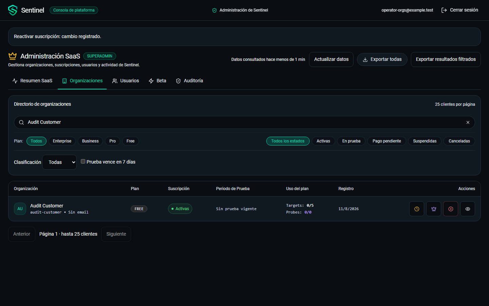
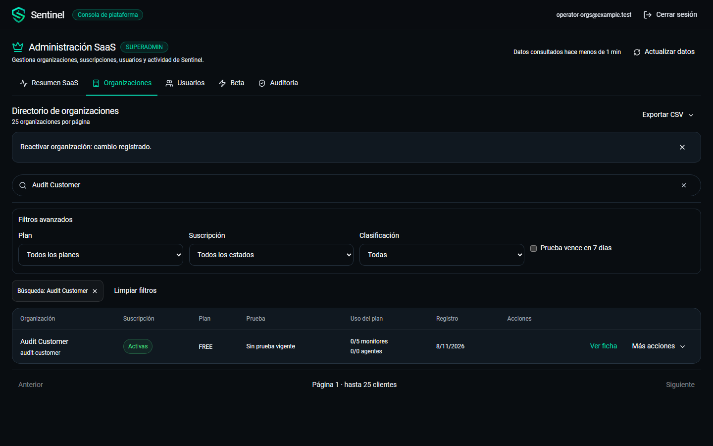
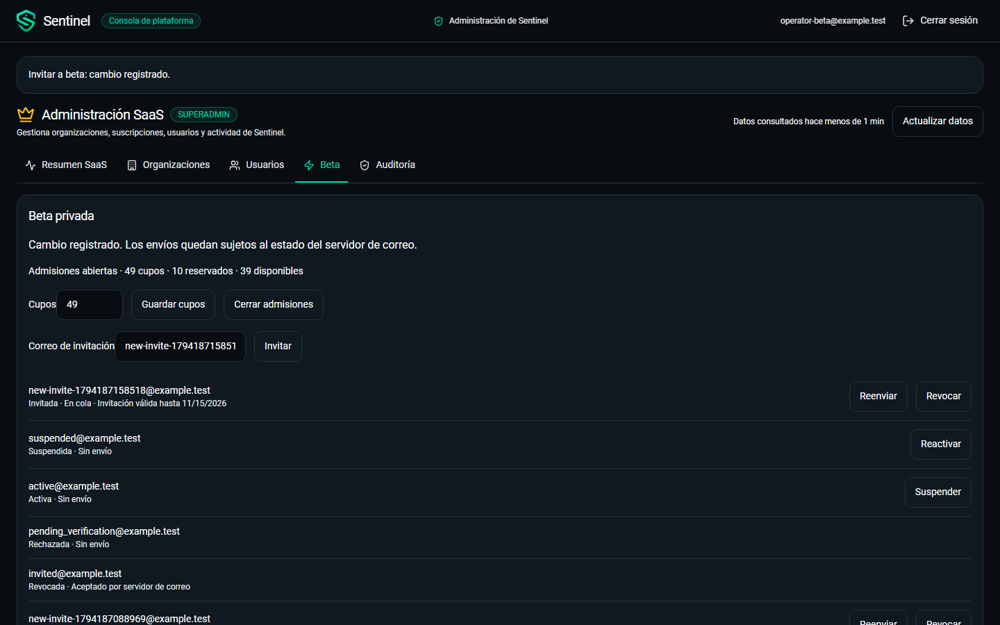
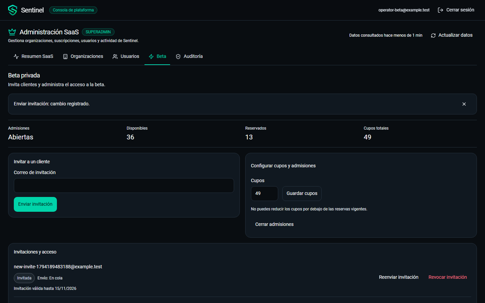
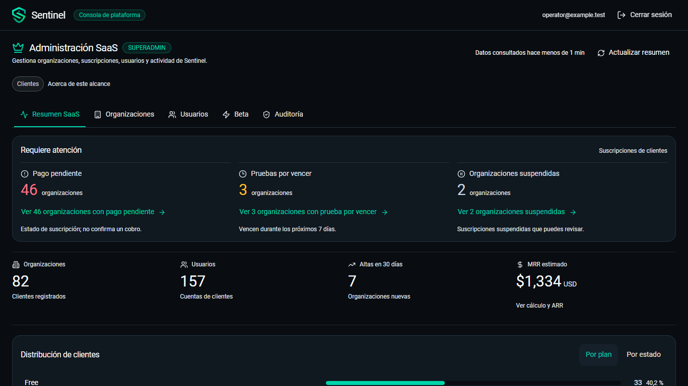
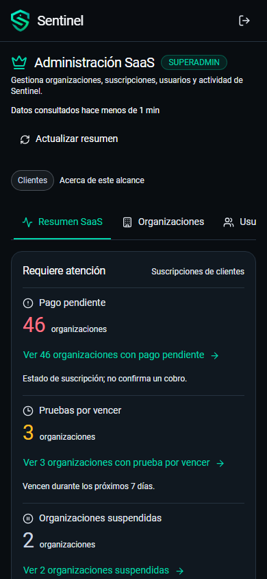

# Rediseño UI/UX de la consola superadmin

Ejecución local del 8 de noviembre de 2026. Complementa la
[validación funcional anterior](PLATFORM_VALIDATION_2026-11-08.md).

## Resultado

Las cinco pestañas conservan su navegación y APIs. El Resumen prioriza atender
clientes: pagos pendientes, pruebas que vencen en siete días y organizaciones
suspendidas. Después presenta cuatro indicadores comerciales, una distribución
con selector Plan/Estado y la capacidad de monitoreo como información secundaria.

Se reutilizan `NavbarFrame`, `NOCPageHeader`, `NOCToolbar`, `NOCKpiCard`,
`ModalSurface`, `EmptyState`, Lucide y los tokens de Sentinel. El modo compacto
de `NOCKpiCard` es opcional; sus consumidores anteriores conservan su presentación.
Los estilos de la consola y sus diálogos tienen alcance específico.

No se añadieron dependencias, migraciones, permisos ni cambios de autenticación
en esta entrega visual. Las migraciones y APIs descritas en la validación anterior
siguen siendo requisitos de la consola.

## Comparación visual

Capturas con datos sintéticos `example.test`, sin cuentas de clientes reales.
El antes/después de Organizaciones y Beta usa el entorno aislado; las fechas,
reservas y resultados pueden variar entre ejecuciones. Las imágenes del Resumen
usan una respuesta controlada, identificada como fixture en las pruebas.

| Organizaciones: antes | Organizaciones: después |
| --- | --- |
|  |  |

Se sustituyeron las acciones representadas únicamente por iconos y las filas
permanentes de filtros por una búsqueda visible, filtros avanzados, etiquetas
removibles, «Ver ficha» y «Más acciones». La exportación tiene un único acceso
con alcance explícito para resultados filtrados o todas las organizaciones.

| Beta: antes | Beta: después |
| --- | --- |
|  |  |

La invitación es la tarea principal. Admisiones y cupos aparecen primero;
configuración, estado de cuenta, vigencia de invitación y envío están separados.

| Resumen: escritorio 1366×768 | Resumen: móvil 390×844 |
| --- | --- |
|  |  |

## Matriz por pestaña y opción

| Área / acción realizada | Resultado esperado y obtenido | Evidencia / límite |
| --- | --- | --- |
| Resumen: enlaces de atención | Abren clientes con `past_due`, `trialing` + `trial_expiring=true`, o `suspended`; página 1 | Tres destinos comprobados con interceptación de solicitudes |
| Resumen: cero pendientes | Texto neutro por criterio, sin botón destacado; cero agentes muestra «Sin agentes registrados» | Fixture de ceros; no se suman categorías |
| Resumen: indicadores | Organizaciones, usuarios, altas en 30 días y MRR completos en la primera pantalla de escritorio | 1440×900 y 1366×768; MRR sigue siendo estimado |
| Resumen: distribución | Selector Plan/Estado conserva barras, conteo, porcentaje y navegación filtrada | Prueba de enlace por plan y capturas |
| Organizaciones: búsqueda y filtros | Búsqueda conservada, filtros combinados y removibles, retorno con contexto y páginas de 25 | API real: búsqueda, plan, estado, clasificación y página 2 |
| Organizaciones: exportar | Un control abre dos opciones identificadas por alcance y descarga CSV | Ambas descargas con API real |
| Organizaciones: ficha | Identidad, plan y estado primero; datos agrupados y secciones cargadas bajo demanda | API real: General, Usuarios, Infraestructura y Auditoría |
| Organizaciones: cambios | Cambiar plan, extender prueba, clasificar, suspender y reactivar requieren motivo y botón específico | Acciones ejecutadas únicamente sobre fixtures aisladas |
| Usuarios: directorio | Identidad y estado primero; filtros secundarios en sección desplegable | API real: organización, rol, correo confirmado y 2FA |
| Usuarios: ficha | Muestra los datos de la consulta y su fecha, acceso a organización y Auditoría | Ficha de lectura del registro cargado; no inventa un nuevo endpoint |
| Usuarios: acciones | Activar, desactivar, cambiar rol y cerrar sesiones mediante confirmación con nombre de acción | API real: cinco acciones; protecciones del backend conservadas |
| Beta: cupos y admisiones | Acciones independientes; disponibles, reservados y totales visibles | Guardar cupos, cerrar y abrir comprobados con API real |
| Beta: invitaciones | Enviar, reenviar, revocar y rechazar requieren motivo; suspender/reactivar tiene confirmación propia | API real y correo simulado `locmem`; ningún envío real |
| Beta: vigencia | Una cuenta activa no se describe como vencida por la fecha de invitación | Vigencia mostrada sólo para invitación o verificación pendientes |
| Auditoría: edición de filtros | Usuario/organización y fechas primero; editar, rango rápido y volver a pestaña no solicitan eventos | Conteo de solicitudes: cero antes de Consultar |
| Auditoría: consulta aplicada | Botón manual, etiquetas y fecha de consulta; editar conserva claramente los resultados previos | Pruebas controladas y API real, paginación de 25 y página 2 conservada |
| Auditoría: fechas y detalle | Rango invertido bloquea consulta; detalle sólo al solicitarlo y con campos permitidos | API real; detalle acotado; validación backend anterior conservada |
| Acciones, teclado y tacto | Controles de 44 px, foco visible, Escape y retorno al origen | Menú, ficha, secciones cerradas, diálogo anidado y taps en contexto Chromium con tacto emulado |
| Sesión y portal | Navbar compartida sin texto central duplicado; sesión administrativa independiente | Regresiones de autenticación, cierre, aviso y expiración |

El recorrido con teclado detectó que Chromium conserva cajas de layout de
controles dentro de `details` cerrados. `useDialogFocus` ahora incluye `summary`
y excluye los controles de esas secciones; así evita enfocar contenido invisible.
Se comprobó el retorno del foco al cerrar un diálogo anidado y después la ficha.
La navegación revela horizontalmente la pestaña activa al cambiar de sección o
de tamaño, sin desplazar verticalmente el contenido. Se deja margen para su foco
y se verificó la visibilidad completa de cada pestaña seleccionada en móvil.

## Evidencia local

| Comprobación | Resultado |
| --- | --- |
| Django completo en PostgreSQL/Redis aislados | 332 aprobadas |
| TypeScript `--noEmit` y build Vite | Aprobados tras el último cambio de código |
| Chromium general final | 227 aprobadas; 3 casos aislados omitidos en esta invocación y ejecutados aparte |
| Chromium superadmin con API real | 3/3 aprobadas tras el último cambio de código |
| Recorridos nuevos de diseño | 4/4 aprobados; también incluidos en la regresión final |
| Guard de archivos versionables y secretos | Aprobado |
| Contratos rápidos Node y guard | 10/10 aprobados |
| `git diff --check` | Aprobado |

Capturas de las cinco pestañas a **1440×900, 1366×768 y 390×844** en
[`assets/platform-redesign`](assets/platform-redesign). La ficha está capturada
en escritorio y móvil, y la confirmación en móvil. Las pruebas verifican que el
documento y el área principal no excedan el ancho de la pantalla. En móvil las
pestañas conservan su desplazamiento horizontal propio.

Pruebas reproducibles: `frontend/e2e/platform-admin.spec.ts`,
`platform-design.spec.ts`, `platform-real.spec.ts`. La última requiere
`PLATFORM_ISOLATED=1`, `seed_platform_audit`, API en 31800 y Vite en 31801.
La suite general usa las fixtures de portal con sufijo `superadmin-final-1108`;
los casos reales se ejecutan por separado para mantener sus fixtures específicas.

Los resultados anteriores son ejecuciones locales. No acreditan CI remoto,
despliegue, una auditoría formal completa WCAG ni entrega a un proveedor real de
correo. La revisión remota de CI y el despliegue continúan como pasos separados.
No se reclasificaron organizaciones existentes del entorno habitual.
API, worker, PostgreSQL, Redis y Vite temporales detenidos al finalizar;
volúmenes de prueba conservados. El entorno habitual no se detuvo.
