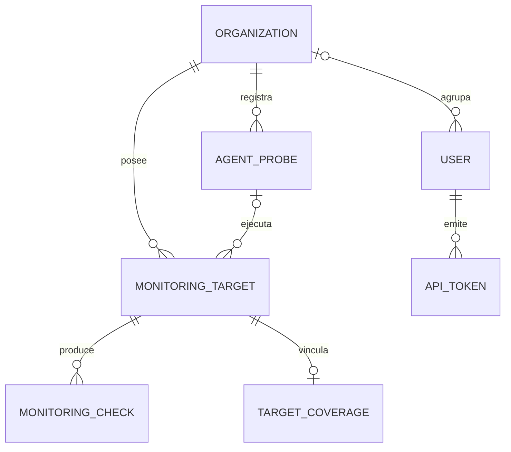

# Referencia técnica de Sentinel

La [referencia OpenAPI](reference-api.json) enumera rutas, métodos, vistas y clases declaradas. Para solicitudes, respuestas y permisos efectivos, sigue la vista y sus serializers. Los controles dinámicos de organización, rol, plan y frecuencia pueden ejecutarse dentro del handler.

El [diccionario PostgreSQL](reference-database.json) enumera tablas físicas, columnas, claves, índices y restricciones visibles mediante la introspección de Django. Los nombres y tipos físicos se pueden contrastar con `pg_dump --schema-only --no-owner --no-privileges` en una base local migrada. Las migraciones describen cómo evolucionó el esquema. Las reglas de borrado de Django se consultan en `on_delete` de cada modelo.

## Relaciones principales



El diagrama resume identidad y monitoreo. Las claves físicas del catálogo son la referencia para consultas SQL. [Inventario por módulo](MODULE_INVENTORY.md).

## Identidad y reglas operativas

| Identidad | Alcance y comprobación |
| --- | --- |
| Viewer | Lectura dentro de su organización. Las mutaciones requieren autorización del módulo. |
| Administrador de organización | Gestiona recursos de su organización sujeto a cuota, estado de suscripción y permisos de la acción. |
| Superadmin | API y sesión administrativas separadas con TOTP. Las operaciones globales usan rutas de plataforma. |
| Token API | Autenticación por token con el alcance concedido. Las operaciones de escritura exigen permiso efectivo de escritura. |
| Sentinine | Usa credenciales de agente y recibe trabajo asignado dentro de su organización. |

Free admite intervalos de monitoreo desde 300 s y Pro desde 60 s. El recurso puede tener un intervalo mayor. Antes de modificar admisión, comprueba cuota, suscripción, frecuencia y reservas en las rutas que puedan crear o ejecutar trabajo. [Planes y onboarding](SUBSCRIPTIONS_ONBOARDING.md) · [Acceso de plataforma](PLATFORM_ACCESS.md).

## Flujos y diagnóstico

| Flujo | Comportamiento y primera comprobación |
| --- | --- |
| Sondeo manual | El POST admitido reserva un `ScanLease` y devuelve 202. El worker persiste el resultado y la interfaz vuelve a consultar el recurso. Si queda pendiente, revisa reserva, cola y worker antes de repetir. |
| Recarga de interfaz | Un GET consulta resultados existentes. Verifica el timestamp de la última medición antes de atribuir un cambio a un sondeo nuevo. |
| Sentinine | Heartbeat y entrega de resultados son señales distintas. Revisa ambos y el estado de la cola local si el agente aparece conectado pero no hay resultados. [Operaciones](SENTI9_OPERATIONS_2026-10-22.md). |
| Verificación y recuperación | Revisa outbox, worker y SMTP si la solicitud se acepta pero el correo no llega. [Flujo de correo](BETA_EMAIL_VERIFICATION.md). |
| Readiness 503 | Revisa PostgreSQL, caché, broker y worker. Repite el healthcheck cuando se recupere la dependencia. [Perímetro productivo](PRODUCTION_SECURITY.md#perímetro). |
| Retención | Antes de aplicar una purga, revisa el dry-run y los límites del plan. Se purgan históricos según la política vigente. [Readiness y datos](PRODUCTION_READINESS.md). |

Las pruebas de negocio están junto a las apps Django. Los flujos de interfaz viven en `frontend/e2e/` y las auditorías de navegador en `frontend/audit/`. Usa fixtures aislados para probar permisos, cuotas, concurrencia o recuperación. [Estrategia y evidencia](TESTING_STRATEGY.md) · [Comandos de validación](DEV_WORKFLOW.md#validaciones-obligatorias).

## Regeneración

Con Compose local levantado y las migraciones aplicadas, ejecuta desde la raíz:

```powershell
docker compose exec -T backend python manage.py migrate --check
foreach ($kind in 'api', 'database') {
    $output = docker compose exec -T backend python manage.py document_contracts $kind
    if ($LASTEXITCODE -ne 0) { throw "Falló la exportación de $kind" }
    $null = ($output -join "`n") | ConvertFrom-Json -AsHashtable
    Set-Content -LiteralPath "docs/reference-$kind.json" -Value $output -Encoding utf8NoBOM
}
```

La exportación de base consulta metadatos. Usa una base local migrada para regenerar y revisar el diff cuando cambien rutas o migraciones.
